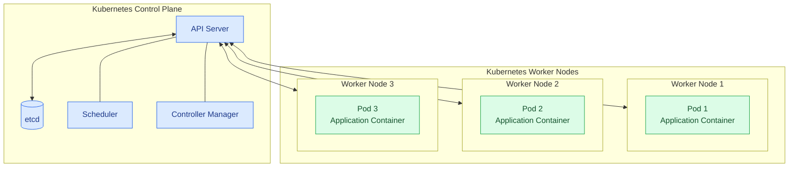
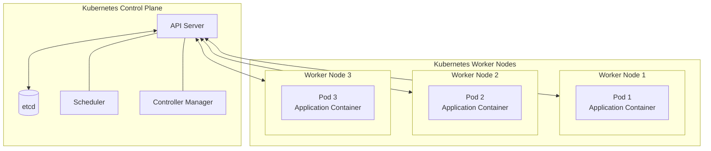

# Kubernetes Architectural Concepts

## 1. Introduction to Kubernetes Architecture

Kubernetes uses a distributed architecture to deploy, manage, and scale containerized applications across multiple machines.

These machines are called **nodes**, and they can be physical servers or virtual machines.

A Kubernetes cluster consists of two main architectural components:

- **Control Plane:** Coordinates cluster operations and manages the desired state of the cluster.
- **Compute Plane (Worker Nodes):** Runs application workloads, usually inside pods.

Together, these components allow Kubernetes to schedule applications, monitor their state, respond to failures, and manage workloads across the cluster.

## 2. Control Plane

The **control plane** is responsible for managing and coordinating the Kubernetes cluster.

It receives requests, maintains cluster state, decides where workloads should run, and ensures that the cluster works toward the desired configuration.

The control plane includes several important components:

- **API Server:** Exposes the Kubernetes API and acts as the main entry point for requests from users, tools, and cluster components.
- **etcd:** Stores Kubernetes cluster state and configuration data.
- **Scheduler:** Selects suitable worker nodes for pods that need to be scheduled.
- **Controller Manager:** Runs controllers that continuously reconcile the actual cluster state with the desired state.

### Example

Suppose an administrator deploys a university portal with three replicas.

The control plane processes the Deployment configuration, coordinates the creation of the required pods, and schedules them onto suitable worker nodes.

If a managed pod becomes unavailable, the relevant controllers work to restore the desired number of replicas.

**In simple terms:** The control plane acts as the brain of the Kubernetes cluster, coordinating what should happen across the cluster.

## 3. Compute Plane (Worker Nodes)

The **compute plane** consists of the nodes that run application workloads.

These nodes provide the resources required to execute application containers, including CPU, memory, storage, and networking.

Each worker node typically contains the following components:

- **Kubelet:** Communicates with the control plane and ensures that assigned pods run according to their specifications.
- **Container Runtime:** Runs containers using a supported runtime, such as containerd or CRI-O.
- **Networking Components:** Enable pod-to-pod and Service communication according to the cluster's networking implementation.

### Example

Suppose a university portal has three replicas distributed across three worker nodes.

- Worker Node 1 runs Portal Pod 1.
- Worker Node 2 runs Portal Pod 2.
- Worker Node 3 runs Portal Pod 3.

Each pod runs the application containers required to serve requests.

Distributing replicas across different nodes can reduce the impact of a single-node failure, provided the workload is configured appropriately.

**In simple terms:** Worker nodes provide the computing resources that run the applications managed by Kubernetes.

## 4. Control Plane vs. Compute Plane

| Feature             | Control Plane                                      | Compute Plane                                     |
| ------------------- | -------------------------------------------------- | ------------------------------------------------- |
| Main responsibility | Manages and coordinates the cluster                | Runs application workloads                        |
| Primary components  | API Server, etcd, Scheduler, Controller Manager    | Kubelet, container runtime, networking components |
| Main purpose        | Maintains cluster state and coordinates scheduling | Executes application pods                         |
| Example             | Decides where a portal pod should run              | Runs the portal pod on a worker node              |

### Why are these roles usually separated?

Although a machine can perform both roles, production clusters commonly separate the control plane from application workloads.

This separation helps with:

- **Stability:** Application workloads are less likely to compete directly with control plane components for resources.
- **Security:** Control plane components can be isolated and protected more effectively.
- **Manageability:** Administrators can maintain and scale cluster infrastructure independently of application workloads.

However, small development or testing clusters may run control plane and workload components on the same machine.

## 5. Kubernetes Cluster Size and Scalability

Kubernetes supports clusters ranging from small single-node environments to large, distributed deployments.

A cluster may contain:

- One node for local development or testing.
- A few nodes for small applications.
- Multiple worker nodes for production applications.
- Thousands of nodes for large-scale workloads.

The maximum supported cluster size depends on the Kubernetes version, infrastructure, configuration, and workload requirements. A commonly documented Kubernetes scalability target is up to 5,000 nodes per cluster under specified conditions.

As clusters grow, administrators must consider resource capacity, networking, storage, scheduling performance, monitoring, and control plane availability.

### Example

A small development environment might run Kubernetes on a single machine.

A production environment might use several dedicated control plane nodes and many worker nodes to distribute application workloads and improve resilience.

## 6. Standard Cluster Architecture

In a standard Kubernetes cluster, the control plane components run on dedicated or designated control plane nodes, while application workloads run on worker nodes.

A typical production architecture includes multiple control plane nodes for high availability and multiple worker nodes for application execution.

The following diagram illustrates the relationship between these components.



<br />


```

Note: This is a simplified architecture diagram. The API server is the central communication point for Kubernetes API operations; the scheduler and controllers interact with it rather than communicating directly with worker nodes for routine management.
```

## 7. Hosted Control Plane Architecture

In a standard architecture, control plane components run directly on dedicated or designated control plane nodes.

An alternative is a **hosted control plane**, in which the control plane for a Kubernetes cluster runs as isolated workloads, commonly pods, on a separate hosting cluster.

The hosting cluster provides the infrastructure needed to operate the hosted control planes, while the workload clusters run their own applications.

### How does it work?

1. A hosting cluster provides the resources for running control plane components.
2. A hosted control plane is created for a tenant or workload cluster.
3. The control plane operates separately from the tenant's application workloads.
4. The workload cluster uses that control plane to manage its own resources and applications.

### Practical example

A cloud provider operates a large Kubernetes hosting cluster and offers separate Kubernetes clusters to multiple organizations.

Instead of dedicating a separate set of physical control plane machines to every tenant, the provider runs isolated hosted control planes on the hosting infrastructure.

Each tenant receives a logically separate Kubernetes control plane for managing its workloads.

### Benefits of hosted control planes

- **Resource efficiency:** Control plane resources can be shared more efficiently across hosting infrastructure.
- **Tenant isolation:** Separate control planes help establish boundaries between tenants when properly configured.
- **Centralized management:** Providers can manage control plane infrastructure through a common platform.
- **Flexible provisioning:** New workload clusters can be created without necessarily provisioning dedicated control plane machines for each one.

Hosted control planes are useful in managed Kubernetes services, multitenant platforms, and environments with strict isolation or governance requirements, including some sovereign cloud deployments.

**Important:** Hosted control planes do not automatically guarantee complete tenant isolation or regulatory compliance. These depend on the overall architecture, access controls, networking, data residency, and operational policies.

## 8. Summary

Kubernetes architecture is built around the relationship between the control plane and the compute plane.

- **Control Plane:** Coordinates the cluster, manages state, and schedules workloads.
- **Compute Plane:** Runs application pods on worker nodes.
- **Standard Architecture:** Typically separates control plane components from application workloads.
- **Scalability:** Supports clusters of different sizes, subject to infrastructure and configuration limits.
- **Hosted Control Planes:** Allow control planes to run as isolated workloads on a separate hosting cluster.

**In simple terms:** The control plane decides and coordinates what should happen, while the compute plane provides the resources that run the applications. Hosted control planes offer an alternative way to organize and operate this architecture at scale.
