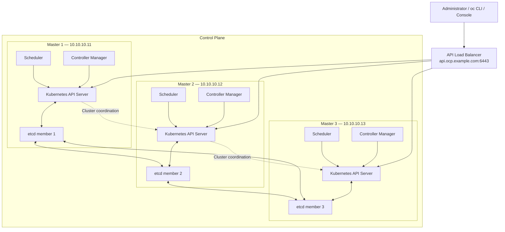
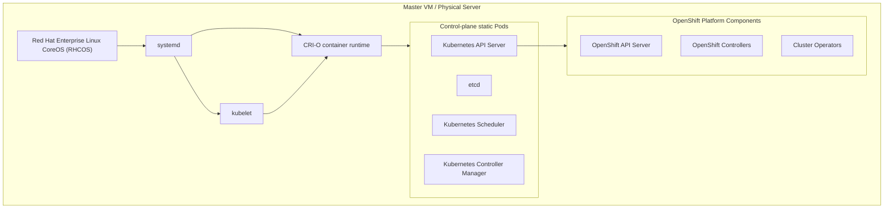
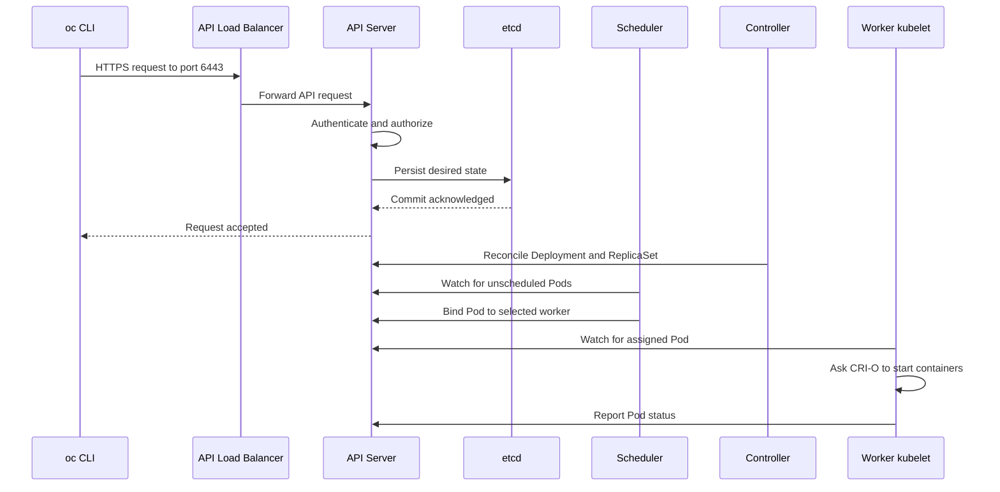
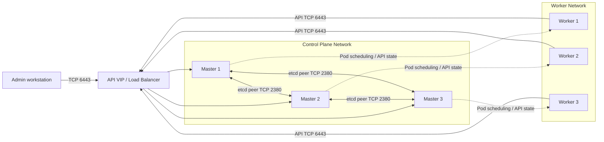
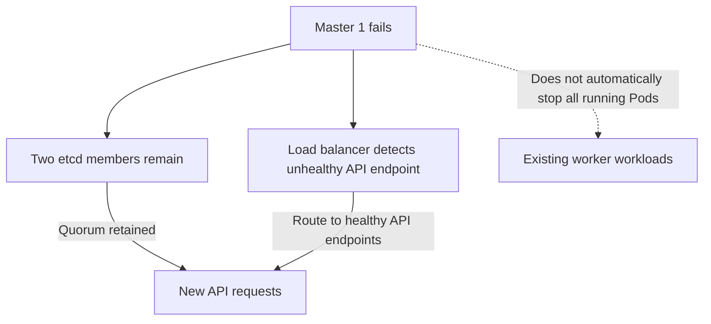

# Diagram 2 — OpenShift control-plane architecture in depth

The control plane is the brain of the cluster. It manages the desired state of the cluster, decides where workloads should run, and coordinates recovery when something fails.

In a standard OpenShift Container Platform deployment, the three control-plane nodes each host control-plane components, including an API Server and an etcd member. OpenShift also runs its own APIs, controllers, and Operators on the control plane.

Red Hat Documentation

+1

## 2.1 Internal architecture of the three master nodes



How to read this diagram:

- The API load balancer distributes incoming API connections to healthy API Server endpoints.
- Each master runs its own control-plane components; the scheduler and controller-manager instances coordinate leader election where applicable.
- Each etcd member participates in a distributed consensus cluster.
- The API Server is the main interface through which Kubernetes clients and controllers interact with cluster state.
- The three masters communicate over the machine network. They do not need to send every application packet through the API Server.

The arrows are logical relationships, not a literal map of every connection. In particular, control-plane components can connect to API endpoints independently, and etcd peer traffic is distinct from API client traffic.

## 2.2 What runs inside a master node?

A master is not just a Linux server running one Kubernetes process. It runs the operating system, node services, control-plane containers, and OpenShift management components.



### Component responsibilities

| Component                     | What it does                                                       |
| ----------------------------- | ------------------------------------------------------------------ |
| RHCOS                         | Provides the operating system and host services.                   |
| kubelet                       | Ensures the required Pods and containers are running on that node. |
| CRI-O                         | Creates and manages containers.                                    |
| Kubernetes API Server         | Validates API requests and exposes Kubernetes resources.           |
| etcd                          | Stores persistent cluster state.                                   |
| Scheduler                     | Assigns unscheduled Pods to suitable nodes.                        |
| Controller Manager            | Reconciles Kubernetes resources toward their desired state.        |
| OpenShift API and controllers | Manage OpenShift-specific resources such as Routes and Projects.   |
| Cluster Operators             | Manage the lifecycle and health of platform components.            |

Static Pods are especially important: kubelet manages them from manifests on the node, rather than relying on the API Server to create those Pods in the first place. This helps the core control plane start even when the cluster API is not yet available.

## 2.3 How etcd quorum works

etcd is a distributed key-value database. It stores the authoritative persistent state used by Kubernetes, including objects representing workloads, configuration, and cluster resources.

With three etcd members, a majority of two members is needed to maintain quorum.

## Three-member etcd cluster

etcd-1

Healthy

etcd-2

Healthy

etcd-3

Failed

Quorum retained: 2 of 3

The cluster can continue processing etcd operations while the remaining members are healthy and communicating.

| Total members | Majority required | Member failures tolerated |
| ------------- | ----------------- | ------------------------- |
| 1             | 1                 | 0                         |
| 3             | 2                 | 1                         |
| 5             | 3                 | 2                         |

If two of the three members fail, quorum is lost. The cluster cannot safely commit new etcd updates until quorum is restored. Existing workloads may continue running on workers, but management and scheduling operations can be impaired.

Production lesson: Three masters do not mean the cluster can survive any two failures. With a three-member etcd cluster, it can generally tolerate only one member failure.

## 2.4 What happens when you deploy an application?

Suppose you run:

bash

```
oc create deployment frontend --image=nginx
```

The request follows this control-plane sequence:



The exact sequence involves asynchronous watches, controller reconciliation, and API updates, so not every action happens in a single linear transaction. The important concept is that the API Server records the desired state, and controllers and node agents work toward making reality match it.

Also, `oc create deployment` does not guarantee the application is immediately ready. The image must be available, a worker must have enough resources, and the Pod must pass its readiness checks.

## 2.5 Control-plane network traffic: which node talks to which?

For a physical/VM installation, these are the important communication paths:



The diagram shows logical connections. Actual connections can use direct node addresses or load-balanced endpoints depending on the component and configuration.

| Traffic              | Typical port | Purpose                                       |
| -------------------- | ------------ | --------------------------------------------- |
| Client to API Server | TCP 6443     | Cluster API access                            |
| etcd peer to peer    | TCP 2380     | Replication and consensus                     |
| API Server to etcd   | TCP 2379     | etcd client requests                          |
| Worker to API        | TCP 6443     | Node registration, watches and status updates |
| Node to node overlay | UDP 6081     | Geneve encapsulation for OVN-Kubernetes       |

Use the port requirements for your exact OpenShift release and network plugin when building firewall rules. See [Red Hat OpenShift control-plane architecture](https://docs.redhat.com/en/documentation/openshift_container_platform/4.16/html/architecture/control-plane?utm_source=chatgpt.com).

Red Hat Documentation

+1

## 2.6 What happens if a master fails?

Imagine master-1 suddenly goes offline.



In a healthy three-master cluster:

1. The API load balancer stops sending new connections to the failed API endpoint after its health checks detect the failure.
2. The two remaining etcd members retain quorum.
3. The surviving control-plane components continue handling requests and reconciling resources.
4. Existing application Pods on healthy workers can generally continue serving traffic.
5. If a workload actually needs to move, Kubernetes must detect the relevant failure and schedule replacement Pods where possible.

A master failure does not automatically mean that all application traffic stops. However, recovery depends on which component failed, how quickly health checks react, and whether the remaining infrastructure has sufficient capacity.

## 2.7 Commands to inspect the control plane

Run these from an authenticated administrative workstation:

bash

```
# List control-plane nodes
oc get nodes -l node-role.kubernetes.io/control-plane

# Check cluster operators
oc get clusteroperators

# Check the API endpoint and cluster version
oc whoami --show-server
oc get clusterversion

# Inspect control-plane Pods
oc get pods -n openshift-kube-apiserver -o wide
oc get pods -n openshift-etcd -o wide
oc get pods -n openshift-kube-scheduler -o wide
oc get pods -n openshift-kube-controller-manager -o wide

# Check etcd health status through the operator
oc get co etcd
```

Some commands require elevated privileges, and Pod names and placement can vary across releases. Do not restart etcd or delete control-plane Pods as a troubleshooting shortcut.

## Diagram 2 recap

The key distinction is:

- API Server: accepts and processes cluster API requests.
- etcd: durably stores cluster state and uses quorum to agree on updates.
- Scheduler: selects a node for each new Pod.
- Controllers: continually reconcile desired and actual state.
- kubelet and CRI-O: turn the assigned workload into running containers.

These are the control mechanisms. The application data path—how browser requests and Pod-to-Pod packets travel—is a separate network path, which we will examine in the following diagrams.

Next: Diagram 3 — DNS, API VIP, load balancers, and the bootstrap process. We'll trace how `api.ocp.example.com` resolves, how the load balancer selects a master, how a new cluster bootstraps, and how DNS and health checks affect cluster availability.
