# Part 1:<br />Diagram 2 — OpenShift control-plane architecture in depth

The control plane is the brain of the cluster. It manages the desired state of the cluster, decides where workloads should run, and coordinates recovery when something fails.

In a standard OpenShift Container Platform deployment, the three control-plane nodes each host control-plane components, including an API Server and an etcd member. OpenShift also runs its own APIs, controllers, and Operators on the control plane.

Red Hat Documentation

+1

## 2.1 Internal architecture of the three master nodes

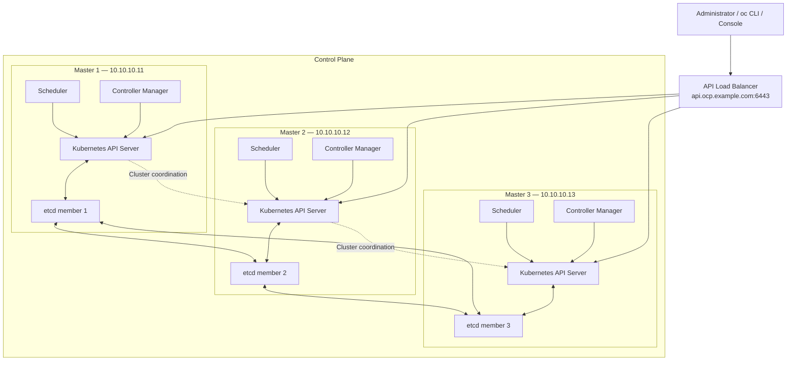

How to read this diagram:

- The API load balancer distributes incoming API connections to healthy API Server endpoints.
- Each master runs its own control-plane components; the scheduler and controller-manager instances coordinate leader election where applicable.
- Each etcd member participates in a distributed consensus cluster.
- The API Server is the main interface through which Kubernetes clients and controllers interact with cluster state.
- The three masters communicate over the machine network. They do not need to send every application packet through the API Server.

The arrows are logical relationships, not a literal map of every connection. In particular, control-plane components can connect to API endpoints independently, and etcd peer traffic is distinct from API client traffic.

## 2.2 What runs inside a master node?

A master is not just a Linux server running one Kubernetes process. It runs the operating system, node services, control-plane containers, and OpenShift management components.

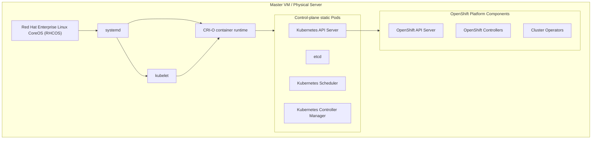

### Component responsibilities

| Component                     | What it does                                                       |
| ----------------------------- | ------------------------------------------------------------------ |
| RHCOS                         | Provides the operating system and host services.                   |
| kubelet                       | Ensures the required Pods and containers are running on that node. |
| CRI-O                         | Creates and manages containers.                                    |
| Kubernetes API Server         | Validates API requests and exposes Kubernetes resources.           |
| etcd                          | Stores persistent cluster state.                                   |
| Scheduler                     | Assigns unscheduled Pods to suitable nodes.                        |
| Controller Manager            | Reconciles Kubernetes resources toward their desired state.        |
| OpenShift API and controllers | Manage OpenShift-specific resources such as Routes and Projects.   |
| Cluster Operators             | Manage the lifecycle and health of platform components.            |

Static Pods are especially important: kubelet manages them from manifests on the node, rather than relying on the API Server to create those Pods in the first place. This helps the core control plane start even when the cluster API is not yet available.

## 2.3 How etcd quorum works

etcd is a distributed key-value database. It stores the authoritative persistent state used by Kubernetes, including objects representing workloads, configuration, and cluster resources.

With three etcd members, a majority of two members is needed to maintain quorum.

## Three-member etcd cluster

etcd-1

Healthy

etcd-2

Healthy

etcd-3

Failed

Quorum retained: 2 of 3

The cluster can continue processing etcd operations while the remaining members are healthy and communicating.

| Total members | Majority required | Member failures tolerated |
| ------------- | ----------------- | ------------------------- |
| 1             | 1                 | 0                         |
| 3             | 2                 | 1                         |
| 5             | 3                 | 2                         |

If two of the three members fail, quorum is lost. The cluster cannot safely commit new etcd updates until quorum is restored. Existing workloads may continue running on workers, but management and scheduling operations can be impaired.

Production lesson: Three masters do not mean the cluster can survive any two failures. With a three-member etcd cluster, it can generally tolerate only one member failure.

## 2.4 What happens when you deploy an application?

Suppose you run:

bash

```
oc create deployment frontend --image=nginx
```

The request follows this control-plane sequence:

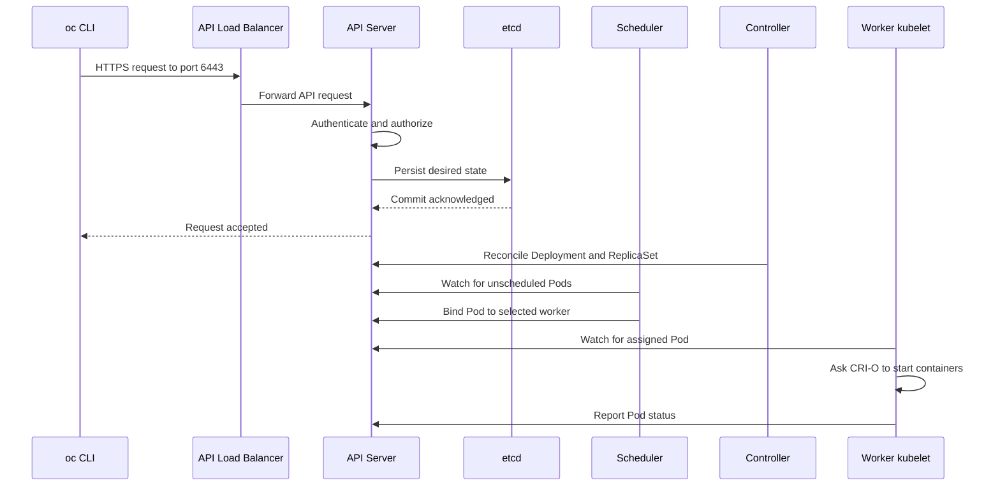

The exact sequence involves asynchronous watches, controller reconciliation, and API updates, so not every action happens in a single linear transaction. The important concept is that the API Server records the desired state, and controllers and node agents work toward making reality match it.

Also, `oc create deployment` does not guarantee the application is immediately ready. The image must be available, a worker must have enough resources, and the Pod must pass its readiness checks.

## 2.5 Control-plane network traffic: which node talks to which?

For a physical/VM installation, these are the important communication paths:

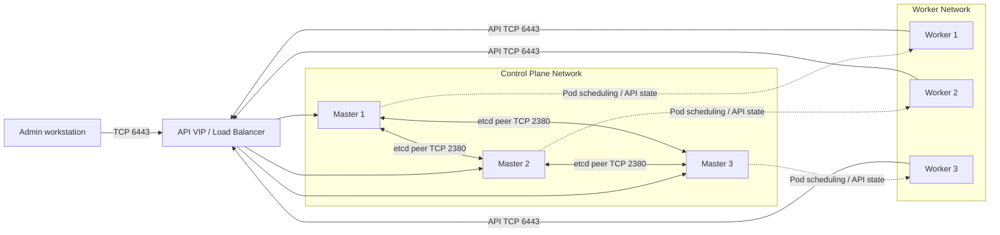

The diagram shows logical connections. Actual connections can use direct node addresses or load-balanced endpoints depending on the component and configuration.

| Traffic              | Typical port | Purpose                                       |
| -------------------- | ------------ | --------------------------------------------- |
| Client to API Server | TCP 6443     | Cluster API access                            |
| etcd peer to peer    | TCP 2380     | Replication and consensus                     |
| API Server to etcd   | TCP 2379     | etcd client requests                          |
| Worker to API        | TCP 6443     | Node registration, watches and status updates |
| Node to node overlay | UDP 6081     | Geneve encapsulation for OVN-Kubernetes       |

Use the port requirements for your exact OpenShift release and network plugin when building firewall rules. See [Red Hat OpenShift control-plane architecture](https://docs.redhat.com/en/documentation/openshift_container_platform/4.16/html/architecture/control-plane?utm_source=chatgpt.com).

Red Hat Documentation

+1

## 2.6 What happens if a master fails?

Imagine master-1 suddenly goes offline.

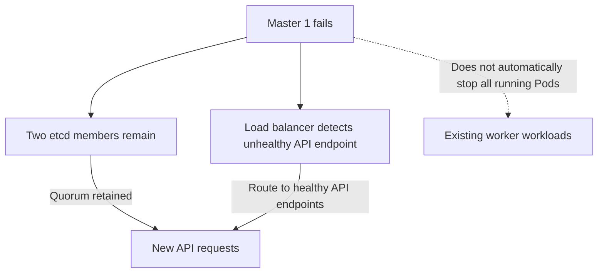

In a healthy three-master cluster:

1. The API load balancer stops sending new connections to the failed API endpoint after its health checks detect the failure.
2. The two remaining etcd members retain quorum.
3. The surviving control-plane components continue handling requests and reconciling resources.
4. Existing application Pods on healthy workers can generally continue serving traffic.
5. If a workload actually needs to move, Kubernetes must detect the relevant failure and schedule replacement Pods where possible.

A master failure does not automatically mean that all application traffic stops. However, recovery depends on which component failed, how quickly health checks react, and whether the remaining infrastructure has sufficient capacity.

## 2.7 Commands to inspect the control plane

Run these from an authenticated administrative workstation:

bash

```
# List control-plane nodes
oc get nodes -l node-role.kubernetes.io/control-plane

# Check cluster operators
oc get clusteroperators

# Check the API endpoint and cluster version
oc whoami --show-server
oc get clusterversion

# Inspect control-plane Pods
oc get pods -n openshift-kube-apiserver -o wide
oc get pods -n openshift-etcd -o wide
oc get pods -n openshift-kube-scheduler -o wide
oc get pods -n openshift-kube-controller-manager -o wide

# Check etcd health status through the operator
oc get co etcd
```

Some commands require elevated privileges, and Pod names and placement can vary across releases. Do not restart etcd or delete control-plane Pods as a troubleshooting shortcut.

## Diagram 2 recap

The key distinction is:

- API Server: accepts and processes cluster API requests.
- etcd: durably stores cluster state and uses quorum to agree on updates.
- Scheduler: selects a node for each new Pod.
- Controllers: continually reconcile desired and actual state.
- kubelet and CRI-O: turn the assigned workload into running containers.

These are the control mechanisms. The application data path—how browser requests and Pod-to-Pod packets travel—is a separate network path, which we will examine in the following diagrams.

Next: Diagram 3 — DNS, API VIP, load balancers, and the bootstrap process. We'll trace how `api.ocp.example.com` resolves, how the load balancer selects a master, how a new cluster bootstraps, and how DNS and health checks affect cluster availability.

## Diagram 1 — Complete OpenShift control-plane architecture

```mermaid
flowchart TB
    ADMIN["Administrator / oc CLI / Web Console / CI-CD"]
    DNS["DNS: api.ocp.example.com"]
    LB["API Load Balancer / API VIP :6443"]

    ADMIN --> DNS --> LB

    subgraph CP["OPENSHIFT CONTROL PLANE — 3 MASTER NODES"]
        direction TB

        subgraph M1["MASTER 1 — 10.10.10.11"]
            direction TB
            OS1["RHCOS / Linux Kernel / systemd"]
            K1["kubelet"]
            R1["CRI-O"]
            A1["Kubernetes API Server"]
            E1["etcd Member 1"]
            S1["Kubernetes Scheduler"]
            C1["Kubernetes Controller Manager"]
            OS1 --> K1
            OS1 --> R1
            K1 --> R1
            K1 -. "Static Pod manifests" .-> A1
            K1 -.-> E1
            K1 -.-> S1
            K1 -.-> C1
        end

        subgraph M2["MASTER 2 — 10.10.10.12"]
            direction TB
            OS2["RHCOS / Linux Kernel / systemd"]
            K2["kubelet"]
            R2["CRI-O"]
            A2["Kubernetes API Server"]
            E2["etcd Member 2"]
            S2["Kubernetes Scheduler"]
            C2["Kubernetes Controller Manager"]
            OS2 --> K2
            OS2 --> R2
            K2 --> R2
            K2 -.-> A2
            K2 -.-> E2
            K2 -.-> S2
            K2 -.-> C2
        end

        subgraph M3["MASTER 3 — 10.10.10.13"]
            direction TB
            OS3["RHCOS / Linux Kernel / systemd"]
            K3["kubelet"]
            R3["CRI-O"]
            A3["Kubernetes API Server"]
            E3["etcd Member 3"]
            S3["Kubernetes Scheduler"]
            C3["Kubernetes Controller Manager"]
            OS3 --> K3
            OS3 --> R3
            K3 --> R3
            K3 -.-> A3
            K3 -.-> E3
            K3 -.-> S3
            K3 -.-> C3
        end
    end

    LB --> A1
    LB --> A2
    LB --> A3

    A1 <--> E1
    A2 <--> E2
    A3 <--> E3

    E1 <-->|"Raft / TCP 2380"| E2
    E2 <-->|"Raft / TCP 2380"| E3
    E1 <-->|"Raft / TCP 2380"| E3

    A1 <-. "API watches / coordination" .-> A2
    A2 <-. "API watches / coordination" .-> A3

    subgraph OCP["OPENSHIFT PLATFORM SERVICES"]
        OAPI["OpenShift API Server"]
        OAUTH["OAuth / Authentication"]
        ROUTE["Ingress Operator / Router"]
        NET["Cluster Network Operator"]
        MCO["Machine Config Operator"]
        CVO["Cluster Version Operator"]
        ETCDOP["etcd Operator"]
        OBS["Monitoring / Alerting"]
    end

    A1 <--> OAPI
    A2 <--> OAUTH
    A3 <--> ROUTE
    A1 <--> NET
    A2 <--> MCO
    A3 <--> CVO
    A1 <--> ETCDOP
    A2 <--> OBS

    subgraph WORKERS["WORKER NODES"]
        W1["Worker 1<br/>kubelet + CRI-O + Pods"]
        W2["Worker 2<br/>kubelet + CRI-O + Pods"]
        W3["Worker 3<br/>kubelet + CRI-O + Pods"]
    end

    W1 -->|"HTTPS API :6443"| LB
    W2 -->|"HTTPS API :6443"| LB
    W3 -->|"HTTPS API :6443"| LB

    classDef api fill:#dbeafe,stroke:#2563eb,color:#111827
    classDef db fill:#dcfce7,stroke:#15803d,color:#111827
    classDef platform fill:#f3e8ff,stroke:#7e22ce,color:#111827
    class A1,A2,A3 api
    class E1,E2,E3 db
    class OAPI,OAUTH,ROUTE,NET,MCO,CVO,ETCDOP,OBS platform
```

## Part 2:

## <br />Diagram 2 — Deep internal architecture of a master node

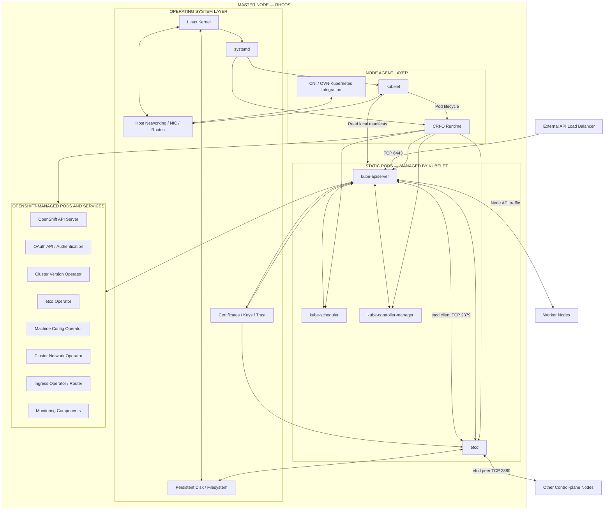

## Diagram 3 — API Server request lifecycle, authentication, authorization, admission, and persistence

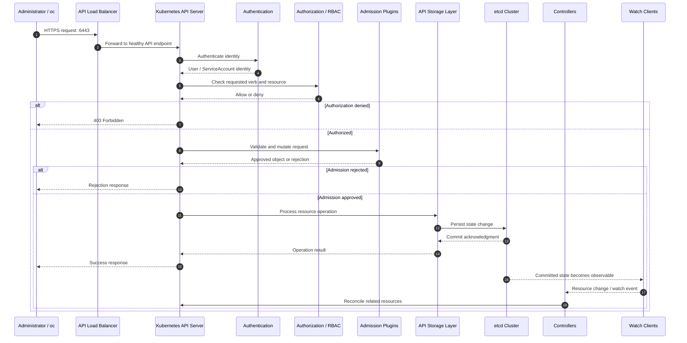

## Diagram 4 — Three-member etcd architecture and Raft consensus

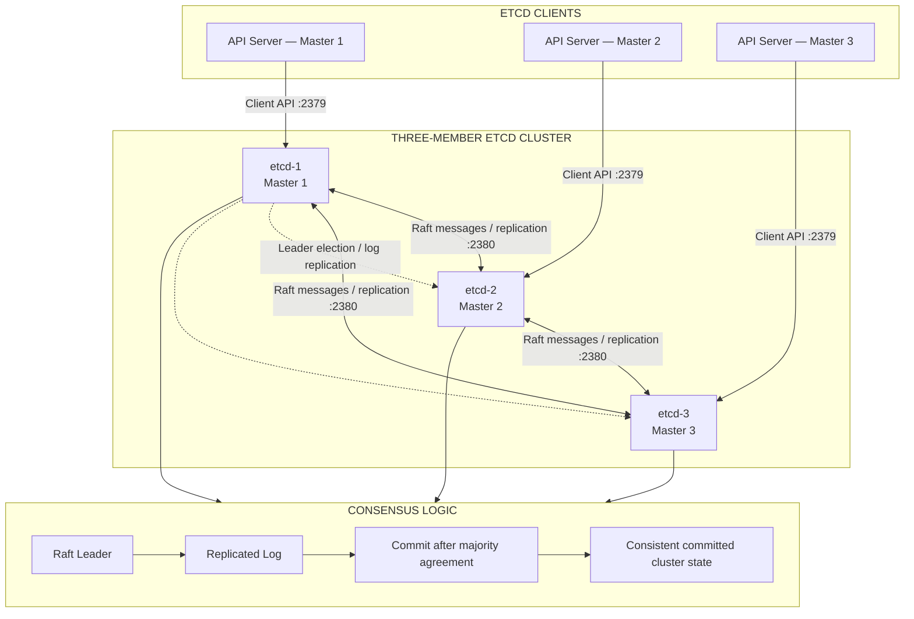

## Diagram 5 — Interactive etcd quorum and failure scenarios

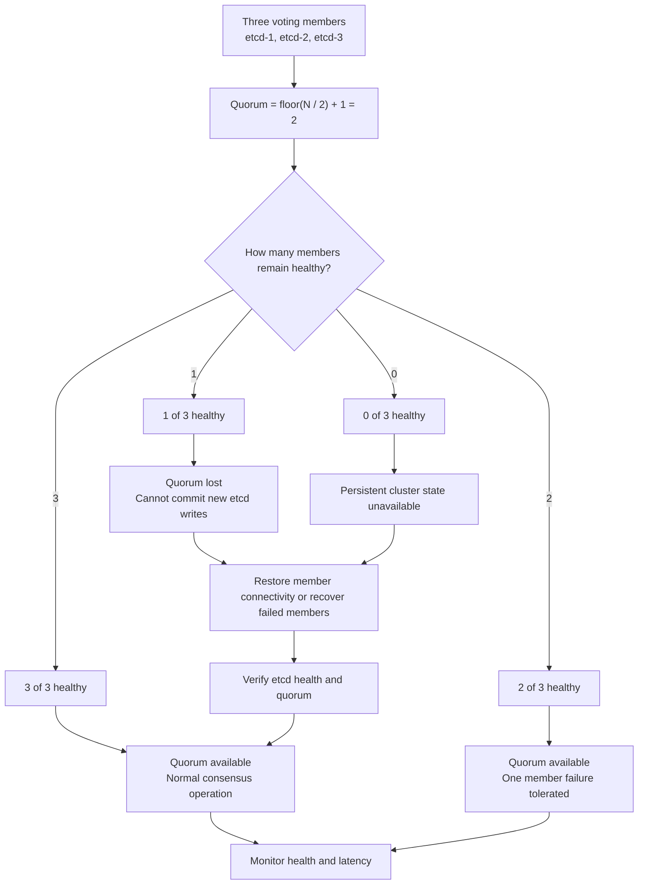

## Diagram 6 — Deployment creation: complete control-plane-to-worker sequence

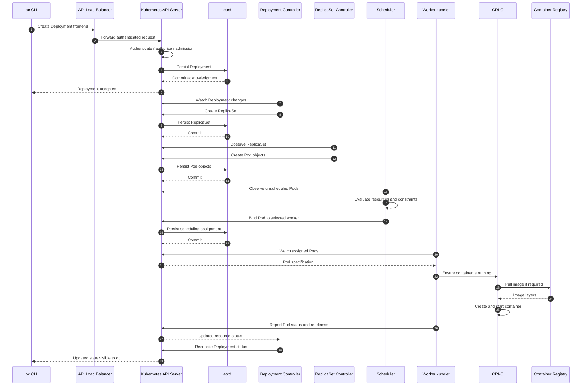

## Diagram 7 — Desired state reconciliation and self-healing

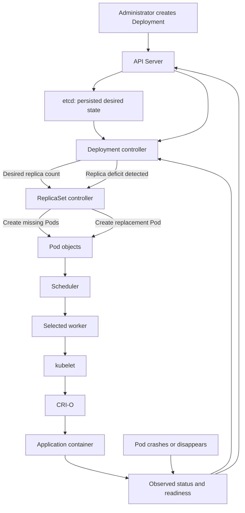

## Diagram 8 — Scheduler internals and Pod placement

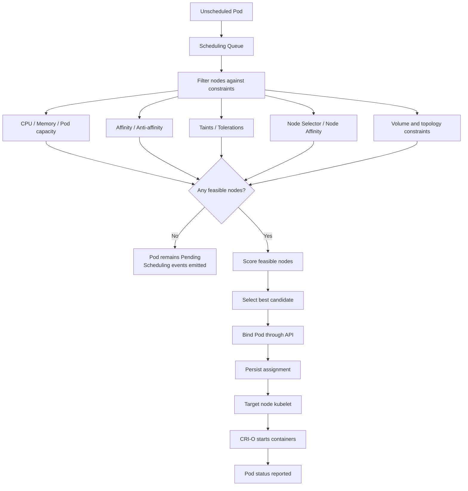

## Diagram 9 — Leader election and controller-manager high availability

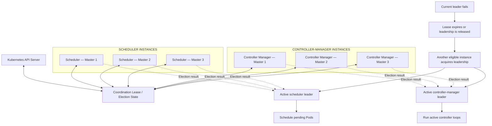

## Diagram 10 — OpenShift Operators and platform lifecycle management

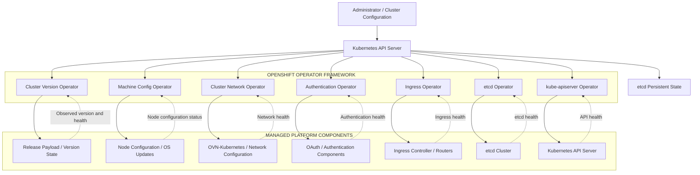

## Diagram 11 — API traffic, etcd traffic, node traffic, and Pod data plane

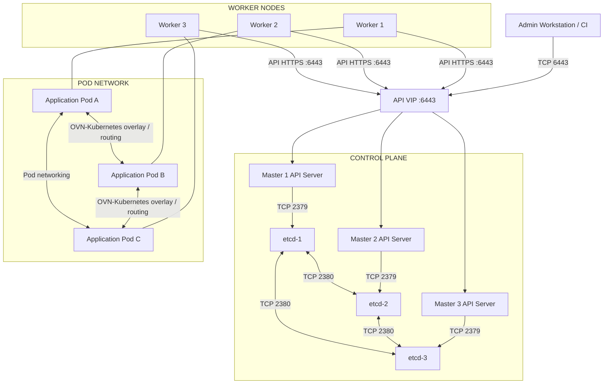

## Diagram 12 — Master failure and recovery

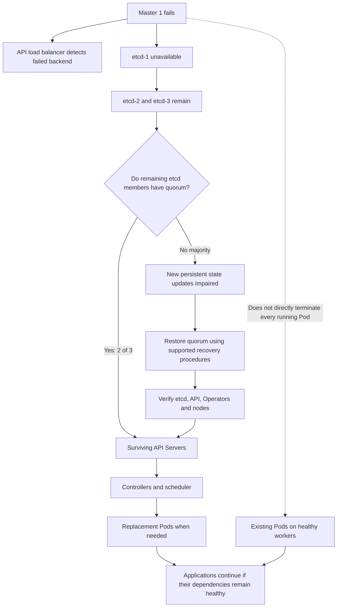

## Diagram 13 — Troubleshooting decision tree

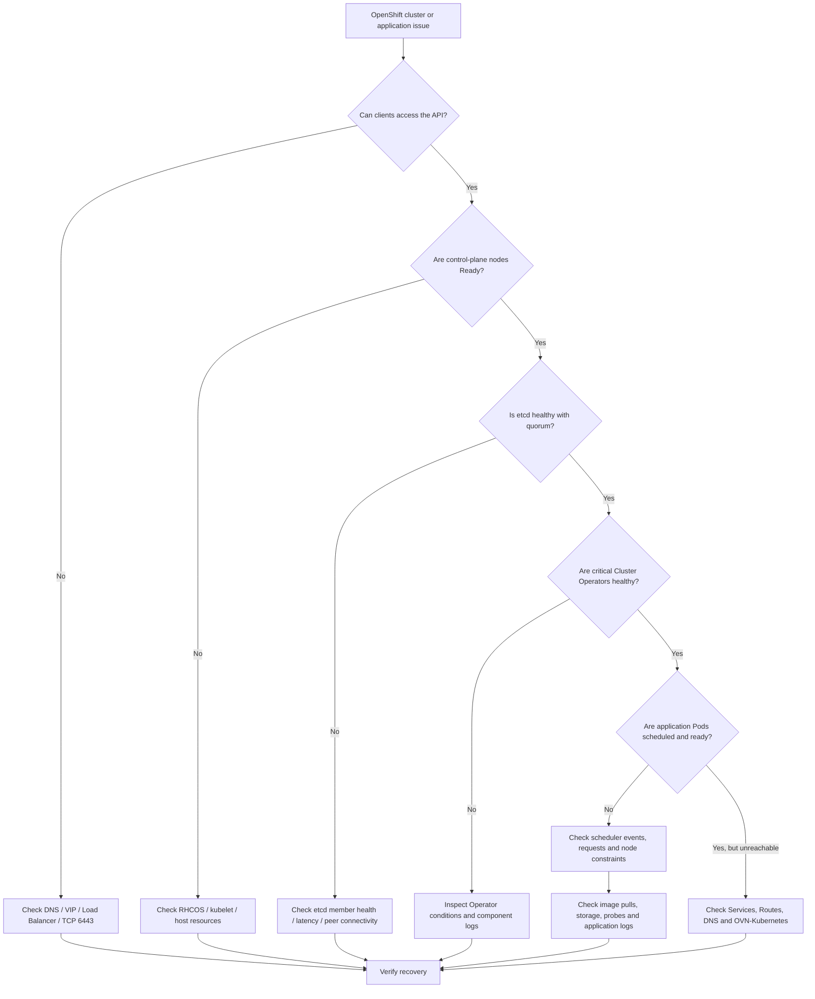

## Diagram 14 — Complete end-to-end architecture: management plane versus application data plane

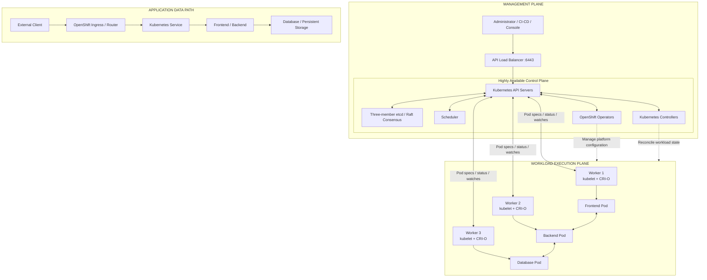

<br /><br />

# Part 3:

# OpenShift Multi-Node Architecture — Complete Installation, IP Addressing, Pods, Logs and Network Configuration

Let's take your 14 diagrams into the next level: how an OpenShift cluster is actually installed, configured, addressed, operated, and troubleshot in a physical/VM environment.

We'll use a realistic on-premises OpenShift 4.x cluster with three control-plane nodes and three worker nodes. We'll cover the installation files, `install-config.yaml`, pull secret, SSH key, node IPs, API and ingress VIPs, Pod IPs, Service IPs, networking, logs, certificates, and what happens internally when a Pod starts.

All IP addresses, credentials, DNS names, and example file paths below are illustrative. Use the installation instructions for your specific OpenShift release and platform.

## Complete architecture and configuration roadmap

### 01

Infrastructure and IP address plan

Physical servers, VMs, NICs, VLANs, DNS, VIPs, DHCP and static IPs.

### 02

Installation configuration and credentials

install-config.yaml, pull secret, SSH key, manifests, ignition and installer.

### 03

Bootstrap and cluster installation

Bootstrap VM, temporary control plane, machine configuration and bootstrap removal.

### 04

Node operating system and services

RHCOS, systemd, kubelet, CRI-O, certificates, disks and interfaces.

### 05

Every important Pod and namespace

API Server, etcd, OVN, DNS, ingress, monitoring and Operator Pods.

### 06

Pod IP, Service IP and node IP

CIDRs, interfaces, veth pairs, OVN logical switches, Geneve and DNS.

### 07

Application request and packet flow

Load balancer to router Pod to Service to application Pod and return traffic.

### 08

Logs, events and troubleshooting

Pod logs, node journals, audit logs, OVN logs, etcd logs and packet captures.

### 09

Storage and persistent data

PVCs, PVs, CSI, storage networks, attachment and mount flow.

### 10

Security and failure recovery

Pull secrets, RBAC, certificates, firewall ports, node failures and backups.

# Part 1 — Full physical/VM infrastructure and IP address plan

## Diagram 1: The infrastructure before OpenShift is installed

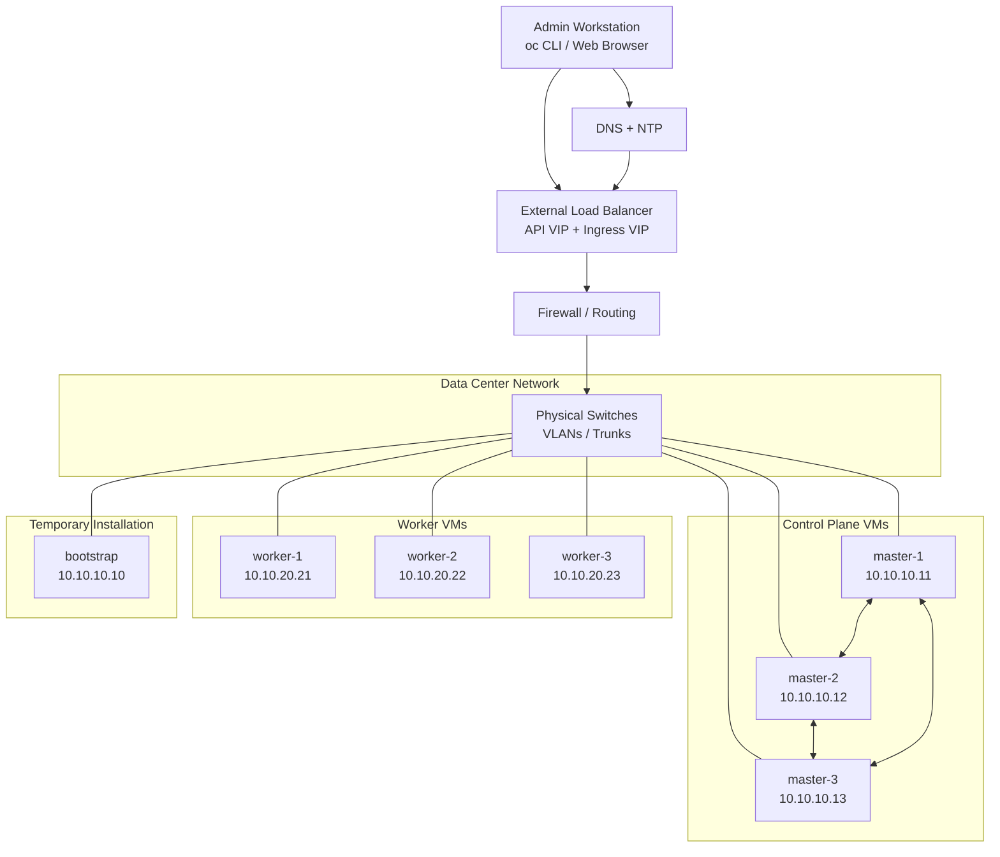

The bootstrap machine is temporary for a conventional installer-provisioned deployment. After the cluster finishes bootstrapping, you normally remove that machine. Other installation methods, including agent-based installation, have different workflows.

## Diagram 2: Example IP addressing and DNS configuration

Here is one possible addressing plan for the lab.

| Item             | Example address | Purpose                              |
| ---------------- | --------------- | ------------------------------------ |
| Bootstrap VM     | `10.10.10.10`   | Temporary cluster bootstrap          |
| Master 1         | `10.10.10.11`   | Control plane                        |
| Master 2         | `10.10.10.12`   | Control plane                        |
| Master 3         | `10.10.10.13`   | Control plane                        |
| Worker 1         | `10.10.20.21`   | Workloads and possibly ingress       |
| Worker 2         | `10.10.20.22`   | Workloads                            |
| Worker 3         | `10.10.20.23`   | Workloads                            |
| API VIP          | `10.10.10.100`  | Kubernetes API endpoint              |
| API internal VIP | `10.10.10.101`  | Internal API endpoint, if configured |
| Ingress VIP      | `10.10.20.100`  | Application traffic entry point      |
| Pod CIDR         | `10.128.0.0/14` | Example Pod network                  |
| Service CIDR     | `172.30.0.0/16` | Example Service network              |

The internal API VIP is not required in every topology. Whether you need it depends on the installation method, platform, and API endpoint design.

For DNS, a typical zone would include records such as:

| DNS record                                       | Example target                   |
| ------------------------------------------------ | -------------------------------- |
| `api.ocp.example.com`                            | API VIP                          |
| `api-int.ocp.example.com`                        | Internal API endpoint, when used |
| `console-openshift-console.apps.ocp.example.com` | Ingress VIP                      |
| `shop.apps.ocp.example.com`                      | Ingress VIP                      |

The `*.apps.ocp.example.com` wildcard record usually points to the ingress endpoint. Individual Routes are resolved by the router using their hostnames.

Critical distinction: The API VIP, node IP, Pod IP, and Service IP are not interchangeable. They belong to different layers and have different routing behavior.

# Part 2 — `install-config.yaml`, pull secret, SSH key, and installation files

This is where the physical network design becomes an OpenShift cluster.

## 2.1 Installation workflow

```mermaid

flowchart TD
    A["Prepare DNS, VIPs, firewall, storage and VMs"]
    B["Download openshift-install and oc"]
    C["Obtain Red Hat pull secret"]
    D["Generate SSH key pair"]
    E["Create install-config.yaml"]
    F["Run installer to generate installation assets"]
    G["Provision or boot RHCOS nodes"]
    H["Bootstrap starts"]
    I["Control plane and etcd form"]
    J["Workers join and Operators initialize"]
    K["Cluster operators become healthy"]
    L["Remove temporary bootstrap machine"]

    A --> B --> C --> D --> E --> F --> G --> H --> I --> J --> K --> L
```

Before you start, select the installation method:

- Installer-provisioned infrastructure (IPI): The installer provisions supported infrastructure and can manage machines, depending on platform.
- User-provisioned infrastructure (UPI): You prepare the VMs or physical hosts, network, load balancers, and DNS yourself.
- Agent-based installation: You prepare an agent ISO and host-specific configuration; this is particularly useful for on-premises installations.

The examples below focus on on-premises infrastructure. For a fixed set of manually provisioned VMs, UPI is a common option. Agent-based installation is another good option, especially when configuring host-specific networking. The exact configuration differs between them.

Red Hat Documentation

+2

## 2.2 Create the installation working directory

On a supported Linux administration or provisioning machine:

bash

```
mkdir -p ~/ocp-install
cd ~/ocp-install

# Verify the installer version
./openshift-install version

# Verify the CLI version
oc version --client
```

Download the installer and CLI for the same supported OpenShift release from the official Red Hat download portal.

A typical directory may look like this:

text

```

ocp-install/
├── openshift-install
├── oc
├── install-config.yaml
├── pull-secret.json       # Optional separate working copy; protect it
├── ssh/
│   ├── id_ed25519
│   └── id_ed25519.pub
├── manifests/             # Generated during asset creation
├── openshift/             # Generated installation assets
└── auth/                  # Generated credentials and kubeconfig
```

Not every installation method generates the exact same directory structure. Some files are created only after running specific installer commands.

## 2.3 Generate an SSH key pair

bash

```
ssh-keygen -t ed25519 -f ~/.ssh/ocp_cluster -C "ocp-admin"
```

This creates:

- `~/.ssh/ocp_cluster` — private key; protect it and never place it in `install-config.yaml`.
- `~/.ssh/ocp_cluster.pub` — public key; this is the key used in the configuration.

View the public key:

bash

```
cat ~/.ssh/ocp_cluster.pub
```

The public key allows authorized SSH access to the `core` account on RHCOS nodes, subject to your configuration and security policies. It is useful for installation debugging and recovery.

## 2.4 Obtain the pull secret

The pull secret authenticates the installation process and cluster components when downloading images from the registries included in the secret.

Obtain it from the official [Red Hat OpenShift downloads and pull-secret portal](https://console.redhat.com/openshift/downloads?utm_source=chatgpt.com).

A pull secret is JSON data containing registry authentication information. It is not the same thing as an ordinary Kubernetes application Secret, and it should be treated as sensitive credential material.

Do not paste your real pull secret into chats, tickets, public repositories, or screenshots.

## 2.5 Example `install-config.yaml`

For an illustrative UPI-style deployment with manually provisioned nodes, a simplified configuration resembles the following:

yaml

```

apiVersion: v1
baseDomain: example.com

metadata:
  name: ocp

compute:
  - name: worker
    replicas: 3
    architecture: amd64

controlPlane:
  name: master
  replicas: 3
  architecture: amd64

networking:
  networkType: OVNKubernetes
  machineNetwork:
    - cidr: 10.10.0.0/16
  clusterNetwork:
    - cidr: 10.128.0.0/14
      hostPrefix: 23
  serviceNetwork:
    - 172.30.0.0/16

platform:
  none: {}

pullSecret: '<YOUR_PULL_SECRET_JSON>'
sshKey: '<YOUR_SSH_PUBLIC_KEY>'
```

This is an illustrative template, not a complete deployment recipe for every OpenShift release. Validate the schema and requirements for your target release and installation method. For example, an IPI or bare-metal installer-provisioned deployment uses platform-specific settings rather than the `platform: none` UPI configuration shown here.

Red Hat Documentation

+1

### What each field means

| Field                   | Purpose                                                           |
| ----------------------- | ----------------------------------------------------------------- |
| `baseDomain`            | Parent DNS domain used for the cluster's DNS names.               |
| `metadata.name`         | Cluster name, used in generated hostnames and endpoints.          |
| `compute.replicas`      | Requested worker count for the installation method.               |
| `controlPlane.replicas` | Number of control-plane nodes.                                    |
| `machineNetwork`        | Subnet or subnets containing the node network interfaces.         |
| `clusterNetwork`        | Pod address pool and per-node Pod prefix allocation.              |
| `serviceNetwork`        | Virtual IP address pool for ClusterIP Services.                   |
| `networkType`           | Cluster network implementation; this example uses OVN-Kubernetes. |
| `platform`              | Infrastructure provider configuration.                            |
| `pullSecret`            | Registry authentication JSON.                                     |
| `sshKey`                | SSH public key for node access.                                   |

Important: `install-config.yaml` does not universally assign a specific static IP to each manually provisioned VM. With UPI, you normally configure node networking through the operating system provisioning process, DHCP reservations, or the applicable static-network configuration mechanism. With agent-based or installer-provisioned deployments, host-specific configuration depends on the selected workflow.

## 2.6 Protect installation artifacts

Once the installer creates `auth/`, the directory commonly contains files such as:

text

```
auth/
├── kubeconfig
├── kubeadmin-password
└── ...
```

Protect these artifacts:

bash

```
chmod 700 ~/ocp-install
chmod 600 ~/ocp-install/install-config.yaml
```

The `kubeconfig` grants access according to its embedded credentials, and the generated administrator password is sensitive. Back them up securely.

The installer may consume or modify its configuration files during later steps, so retain a secure backup of the intended configuration before proceeding.

# Part 3 — Node IP addresses: how each server gets its IP

## 3.1 Node IP configuration diagram

```mermaid

flowchart TD
    subgraph PROV["Infrastructure / Provisioning"]
        DHCP["DHCP server or reservations"]
        STATIC["Static network configuration"]
        ISO["RHCOS ISO / Agent ISO"]
    end

    subgraph HOSTS["OpenShift Nodes"]
        M1["master-1<br/>10.10.10.11"]
        M2["master-2<br/>10.10.10.12"]
        M3["master-3<br/>10.10.10.13"]
        W1["worker-1<br/>10.10.20.21"]
        W2["worker-2<br/>10.10.20.22"]
        W3["worker-3<br/>10.10.20.23"]
    end

    DHCP --> M1
    DHCP --> M2
    DHCP --> M3
    STATIC --> W1
    STATIC --> W2
    STATIC --> W3
    ISO --> M1
    ISO --> W1
```

For manually provisioned hosts, the node IP is configured by the host's network setup, not by Kubernetes assigning an arbitrary IP from the Pod CIDR.

Typical approaches include:

- DHCP with reservations for stable addresses.
- Static addressing configured during RHCOS provisioning.
- Agent-based installation with host-specific network settings.
- NetworkManager connection profiles applied using the supported machine configuration process.

## 3.2 Inspect the actual IP on a running node

From the OpenShift CLI:

bash

```
oc get nodes -o wide
```

Example output:

text

```
NAME       STATUS   ROLES                  INTERNAL-IP
master-1   Ready    control-plane,master    10.10.10.11
master-2   Ready    control-plane,master    10.10.10.12
master-3   Ready    control-plane,master    10.10.10.13
worker-1   Ready    worker                 10.10.20.21
worker-2   Ready    worker                 10.10.20.22
worker-3   Ready    worker                 10.10.20.23
```

To inspect the host's actual interfaces and routes, use an authorized node-debug session:

bash

```
oc debug node/worker-1
chroot /host

ip -br addr
ip route
ip rule
nmcli device status
nmcli connection show
```

Exit the debug shell when finished.

The `INTERNAL-IP` shown by Kubernetes is the node address selected for cluster communication. It is not the same as the IP of every interface on that host.

# Part 4 — Bootstrap: how the cluster comes alive

## 4.1 Bootstrap architecture

The bootstrap process establishes enough of the control plane for the installed masters to take over. It is a temporary installation phase, not a permanent fourth master.

```mermaid

flowchart TD
    INSTALLER["openshift-install"]
    BOOT["Temporary Bootstrap Host"]
    M1["Master 1"]
    M2["Master 2"]
    M3["Master 3"]
    ETCD["Three-member etcd cluster"]
    API["Stable API endpoint"]
    WORKERS["Worker Nodes"]
    DONE["Bootstrap complete"]

    INSTALLER --> BOOT
    BOOT --> M1
    BOOT --> M2
    BOOT --> M3
    M1 <--> ETCD
    M2 <--> ETCD
    M3 <--> ETCD
    M1 --> API
    M2 --> API
    M3 --> API
    API --> WORKERS
    ETCD --> DONE
```

The sequence is broadly:

1. The installer generates the assets needed to initialize the cluster.
2. Bootstrap starts the initial control-plane installation services.
3. The control-plane nodes establish their API and etcd services.
4. The permanent control plane takes over cluster management.
5. Workers join and the platform Operators initialize.
6. The installer reports completion; the bootstrap host can then be removed when instructed.

Exact timing and intermediate services differ by installation method. Never remove the bootstrap host merely because the API endpoint first responds; wait for the installation process to confirm bootstrap completion.

## 4.2 Installation commands

For an applicable UPI workflow, the general installer commands are:

bash

```
# Generate installation assets
openshift-install create manifests --dir=ocp-install

# Review and apply any documented, pre-install manifest customizations
# before generating ignition assets.

openshift-install create ignition-configs --dir=ocp-install

# Monitor installation progress
openshift-install wait-for bootstrap-complete --dir=ocp-install
openshift-install wait-for install-complete --dir=ocp-install
```

Use these commands only for an installation method that supports this sequence. Agent-based installation follows a different asset-generation workflow, and some IPI workflows manage more of the provisioning automatically.

Set the CLI environment for a completed installation:

bash

```
export KUBECONFIG="$HOME/ocp-install/auth/kubeconfig"

oc get nodes
oc get clusteroperators
```

# Part 5 — Every important Pod, namespace and IP

Now we move inside the running cluster. This is where you can inspect the actual IP addresses and logs for OpenShift platform components.

## 5.1 System namespaces

| Namespace                           | What you find there                                |
| ----------------------------------- | -------------------------------------------------- |
| `openshift-etcd`                    | etcd members and related components                |
| `openshift-kube-apiserver`          | Kubernetes API Server Pods                         |
| `openshift-kube-scheduler`          | Scheduler Pods                                     |
| `openshift-kube-controller-manager` | Controller manager Pods                            |
| `openshift-ovn-kubernetes`          | OVN-Kubernetes networking components               |
| `openshift-dns`                     | Cluster DNS                                        |
| `openshift-ingress`                 | Ingress controller/router Pods                     |
| `openshift-machine-config-operator` | Machine configuration management                   |
| `openshift-monitoring`              | Prometheus, Alertmanager and monitoring components |
| `openshift-authentication`          | Authentication components                          |
| `openshift-cluster-version`         | Cluster version management components              |

The precise Pods and namespaces depend on the OpenShift version, cluster configuration, and enabled Operators.

## 5.2 Inspect Pods, their nodes and their IP addresses

Run:

bash

```
# Pods in every namespace
oc get pods -A

# Pod IPs and node placement
oc get pods -A -o wide

# Find all Pod IPs associated with one node
oc get pods -A -o wide --field-selector spec.nodeName=worker-1

# Inspect a particular Pod
oc describe pod <pod-name> -n <namespace>

# Inspect all Services
oc get svc -A

# Inspect endpoints
oc get endpointslices -A
```

An illustrative application listing:

text

```
NAMESPACE   NAME                       READY   STATUS    IP            NODE
shop-demo   frontend-6d9c8f-abc12      1/1     Running   10.128.0.15   worker-1
shop-demo   frontend-6d9c8f-def34      1/1     Running   10.128.1.18   worker-2
shop-demo   backend-7c9f7d-xyz45       1/1     Running   10.128.2.21   worker-3
```

These Pod IPs are examples only. The actual values come from the cluster's configured Pod CIDRs and networking implementation.

Important: Pods can be recreated with new IP addresses. Applications should normally connect through Kubernetes Services and DNS, not hardcode Pod IPs.

## 5.3 Pod networking diagram

```mermaid

flowchart TB
    subgraph W1["Worker 1 — Node IP 10.10.20.21"]
        P1["Frontend Pod<br/>10.128.0.15"]
        O1["OVN-Kubernetes / OVS"]
        NIC1["Node interface"]
        P1 --- O1 --- NIC1
    end

    subgraph W2["Worker 2 — Node IP 10.10.20.22"]
        P2["Frontend Pod<br/>10.128.1.18"]
        O2["OVN-Kubernetes / OVS"]
        NIC2["Node interface"]
        P2 --- O2 --- NIC2
    end

    subgraph W3["Worker 3 — Node IP 10.10.20.23"]
        P3["Backend Pod<br/>10.128.2.21"]
        O3["OVN-Kubernetes / OVS"]
        NIC3["Node interface"]
        P3 --- O3 --- NIC3
    end

    NIC1 <-->|"Geneve overlay where applicable"| NIC2
    NIC2 <-->|"Geneve overlay where applicable"| NIC3
    NIC1 <-->|"Geneve overlay where applicable"| NIC3
```

The underlying node network transports inter-node traffic. OVN-Kubernetes supplies the logical networking that connects Pods across nodes.

To inspect networking components:

bash

```
oc get pods -n openshift-ovn-kubernetes -o wide
oc get network.config.openshift.io cluster -o yaml
oc get network.operator cluster -o yaml
oc get nodes -o wide
```

# Part 6 — Service IPs, Routes and the application request path

## 6.1 Three different kinds of addresses

Consider a backend application.

| Object          | Example                     | Meaning                                      |
| --------------- | --------------------------- | -------------------------------------------- |
| Worker node     | `10.10.20.22`               | Address of the VM/host                       |
| Backend Pod     | `10.128.2.21`               | Address of one running Pod                   |
| Backend Service | `172.30.50.10`              | Stable virtual Service IP                    |
| External Route  | `shop.apps.ocp.example.com` | DNS hostname for external application access |

The Service IP is a virtual cluster address. It is not normally assigned as an ordinary IP to a physical NIC. The network implementation makes the Service reachable and selects eligible endpoints.

## 6.2 Complete application traffic diagram

```mermaid

flowchart LR
    U["Browser"]
    DNS["External DNS"]
    LB["External Load Balancer"]
    R["Ingress Router Pod"]
    S["Service ClusterIP"]
    F["Frontend Pod"]
    BS["Backend Service"]
    B["Backend Pod"]
    DB["Database"]

    U --> DNS
    DNS --> LB
    LB --> R
    R --> S
    S --> F
    F --> BS
    BS --> B
    B --> DB
```

In a real deployment, the ingress router is usually a replicated set of router Pods. A Route sends traffic to a Service, which directs traffic to eligible application endpoints. An application can then call another Service for backend traffic.

## 6.3 Discover the actual Route and Service addresses

bash

```
oc get routes -A
oc get route shop -n shop-demo -o yaml

oc get svc -n shop-demo -o wide
oc get endpointslices -n shop-demo -o wide

oc get pods -n shop-demo -o wide
```

Check DNS from a machine that can reach the application:

bash

```
dig +short api.ocp.example.com
dig +short shop.apps.ocp.example.com
```

If DNS resolves but the application is unavailable, test each layer separately: load balancer health, firewall rules, ingress router health, Route configuration, Service selectors, endpoint readiness, and application logs.

# Part 7 — Logs: where to find the actual error

OpenShift logs are distributed across the application containers, platform Pods, node operating system, and audit system. There is no single log file that contains everything.

## 7.1 Log architecture

```mermaid

flowchart TB
    subgraph NODE["Worker / Control-plane Node"]
        APP["Application container stdout/stderr"]
        CRIO["CRI-O / kubelet"]
        JOURNAL["systemd journal"]
        AUDIT["API audit log"]
        FILES["Host log files"]
    end

    subgraph API["OpenShift API"]
        PODLOG["oc logs API"]
        EVENTS["Kubernetes Events"]
    end

    subgraph OBS["Centralized Observability"]
        PROM["Prometheus metrics"]
        ALERT["Alertmanager"]
        LOGSTORE["Optional log aggregation backend"]
    end

    APP --> CRIO
    CRIO --> JOURNAL
    APP --> PODLOG
    JOURNAL --> FILES
    AUDIT --> FILES
    PODLOG --> LOGSTORE
    EVENTS --> LOGSTORE
    PROM --> ALERT
    PROM --> LOGSTORE
```

This is a conceptual diagram: the actual log collection pipeline depends on the installed logging stack and configuration. Metrics, logs, events, and audit records are different data sources.

## 7.2 Application Pod logs

bash

```
# List Pods
oc get pods -n shop-demo

# Current logs
oc logs frontend-6d9c8f-abc12 -n shop-demo

# Follow logs live
oc logs -f frontend-6d9c8f-abc12 -n shop-demo

# Previous container instance, useful after a crash
oc logs frontend-6d9c8f-abc12 -n shop-demo --previous

# Logs from a specific container in a multi-container Pod
oc logs <pod-name> -n <namespace> -c <container-name>

# Recent events
oc get events -n shop-demo --sort-by=.lastTimestamp
```

The `--previous` option works when a previous container instance is available. Pod logs may be lost when Pods are deleted unless a suitable logging backend retains them.

## 7.3 Control-plane and networking logs

bash

```
# Inspect API Server Pods
oc get pods -n openshift-kube-apiserver -o wide

# Inspect etcd Pods
oc get pods -n openshift-etcd -o wide

# Inspect network Pods
oc get pods -n openshift-ovn-kubernetes -o wide

# Read a specific component's logs
oc logs <pod-name> -n openshift-kube-apiserver
oc logs <pod-name> -n openshift-etcd
oc logs <pod-name> -n openshift-ovn-kubernetes

# Inspect component health
oc get co
oc get clusterversion
```

Some platform Pods use multiple containers, so use `-c` to select the correct container where necessary.

## 7.4 Node-level logs

For authorized access to a node:

bash

```
oc debug node/worker-1
chroot /host

# Kubelet service logs
journalctl -u kubelet --since "30 minutes ago"

# CRI-O logs
journalctl -u crio --since "30 minutes ago"

# Kernel messages
journalctl -k --since "30 minutes ago"

# Current network state
ip -br addr
ip route
ip neigh
```

RHCOS is managed through OpenShift, so use supported debugging and machine configuration procedures rather than manually changing managed node configuration.

## 7.5 Where are the logs stored?

Common locations and sources include:

| Source           | Typical location or command                                  |
| ---------------- | ------------------------------------------------------------ |
| Container logs   | `oc logs` or node container log files                        |
| Kubelet          | `journalctl -u kubelet`                                      |
| CRI-O            | `journalctl -u crio`                                         |
| Kernel           | `journalctl -k`                                              |
| API audit logs   | `/var/log/kube-apiserver/` on applicable control-plane nodes |
| Cluster events   | `oc get events -A`                                           |
| Centralized logs | Configured logging backend, if installed                     |

Paths can differ by component, release, and configuration. For example, API audit log files are not the same as the application container logs exposed by `oc logs`.

## 7.6 A real troubleshooting example

Suppose `shop.apps.ocp.example.com` returns HTTP 503.

Use this sequence:

bash

```
# 1. Verify the Route
oc get route shop -n shop-demo

# 2. Verify the Service
oc get svc web -n shop-demo

# 3. Check Service endpoints
oc get endpointslices -n shop-demo -o wide

# 4. Verify application Pods and readiness
oc get pods -n shop-demo -o wide

# 5. Inspect application events
oc describe pod <pod-name> -n shop-demo

# 6. Read the application logs
oc logs <pod-name> -n shop-demo --all-containers=true

# 7. Check router health
oc get pods -n openshift-ingress -o wide
```

If the Service has no ready endpoints, inspect the selector, Pod labels, readiness probes, and application health before changing the load balancer. A 503 can have several causes; it does not automatically mean that the physical network is broken.

# Part 8 — Pull secrets, Kubernetes Secrets, certificates and credentials

These are four related but different things.

```mermaid

flowchart TB
    REG["Container Registry"]
    PULL["Image Pull Secret"]
    POD["Pod / kubelet / CRI-O"]
    API["API Server TLS Certificate"]
    CLIENT["oc CLI / API Client"]
    TLS["Application TLS Certificate"]
    ROUTER["Ingress Router"]
    APP["Application"]

    PULL --> POD
    REG --> POD
    CLIENT <-->|"HTTPS / certificate verification"| API
    CLIENT -->|"Authenticated API requests"| API
    TLS --> ROUTER
    ROUTER --> APP
```

- Pull secret: Used to authenticate to container registries when pulling images.
- Kubernetes Secret: Stores application or platform data such as passwords, tokens, or certificates. Its protection depends on RBAC and the cluster's encryption-at-rest configuration.
- API certificate: Used to establish trusted TLS connections to the Kubernetes API.
- Ingress certificate: Used to secure HTTPS connections to applications exposed through Routes.

Inspect application Secrets without displaying their values:

bash

```
oc get secrets -n shop-demo

# Inspect metadata and type, but not decoded credential contents
oc describe secret <secret-name> -n shop-demo

# Inspect API serving certificate metadata where appropriate
oc get apiservers.operator.openshift.io cluster -o yaml

# Inspect ingress configuration
oc get ingresscontroller -n openshift-ingress-operator
```

Do not share the output of commands that reveal passwords, tokens, private keys, or complete Secret objects.

# Part 9 — How all the network addresses relate

Here is the complete address hierarchy, from the user's browser down to the application container.

```mermaid

flowchart TD
    EXT["External Client"]
    DNS["DNS: shop.apps.ocp.example.com"]
    VIP["Ingress VIP / Load Balancer"]
    NODE["Worker Node IP"]
    ROUTER["Ingress Router Pod IP"]
    SVC["Service ClusterIP"]
    POD["Backend Pod IP"]
    APP["Application Container Port"]

    EXT --> DNS --> VIP
    VIP --> NODE
    NODE --> ROUTER
    ROUTER --> SVC
    SVC --> POD
    POD --> APP

    API["API VIP / api.ocp.example.com:6443"]
    MASTER["Control-plane Node IPs"]
    EXT -. "Separate management path" .-> API
    API --> MASTER
```

For an application request, the API VIP is not normally part of the HTTP data path. The API endpoint manages cluster resources, while the ingress endpoint accepts application traffic.

A Pod IP is also not the same as a container port. For example, a backend Pod could have IP `10.128.2.21` and listen on port `8080`, giving it the endpoint `10.128.2.21:8080`.

# Part 10 — Installation validation checklist

Before considering an on-premises cluster production-ready, validate each layer independently.

## Deployment readiness

0 / 19 checked

### Infrastructure

\[ ]All master and worker VMs have stable IP addresses.

\[ ]CPU, memory, disk, and hypervisor capacity meet the chosen release requirements.

\[ ]Redundant network paths and switches are configured where required.

### DNS and load balancers

\[ ]API and internal API records resolve correctly where required.

\[ ]Application wildcard DNS points to the intended ingress endpoint.

\[ ]API load balancer targets healthy control-plane API endpoints.

\[ ]Ingress load balancer targets the configured router endpoints.

### Installation assets

\[ ]Installer and CLI versions match the intended release.

\[ ]Pull secret is valid and protected.

\[ ]SSH public key is configured.

\[ ]install-config.yaml matches the selected platform and installation method.

### Cluster networking

\[ ]Machine, Pod, and Service CIDRs do not overlap improperly.

\[ ]Required node-to-node and control-plane ports are allowed.

\[ ]MTU and overlay encapsulation work across the infrastructure.

\[ ]DNS, NTP, image registry, and storage dependencies are reachable.

### Cluster health

\[ ]All expected nodes become Ready.

\[ ]Critical Cluster Operators report healthy status.

\[ ]etcd has quorum and is healthy.

\[ ]Application Pods are ready and Services have valid endpoints.

Copy checklist

## Official documentation

For version-specific details, use the matching release documentation:

- [OpenShift Container Platform 4.22 — Agent-based installation](https://docs.redhat.com/en/documentation/openshift_container_platform/4.22/html/installing_an_on-premise_cluster_with_the_agent-based_installer/preparing-to-install-with-agent-based-installer?utm_source=chatgpt.com) — configuration, pull secret and host networking.
  Red Hat Documentation
- [OpenShift Container Platform 4.22 — User-provisioned infrastructure on bare metal](https://docs.redhat.com/en/documentation/openshift_container_platform/4.22/html/installing_on_bare_metal/user-provisioned-infrastructure?utm_source=chatgpt.com) — manual infrastructure and installation configuration.
  Red Hat Documentation
- [OpenShift Container Platform 4.20 — Bare-metal installation](https://docs.redhat.com/en/documentation/openshift_container_platform/4.20/html-single/installing_on_bare_metal/installing_on_bare_metal?utm_source=chatgpt.com) — sample `install-config.yaml` and network configuration.
  Red Hat Documentation

Recommended next step: Work through a single real installation end to end, using your intended OpenShift release and deployment method. That lets us tie the IP plan, configuration files, bootstrap logs, node registration, Pod IPs, Routes, and packet traces to one consistent environment rather than mixing configuration examples from different installation methods.
